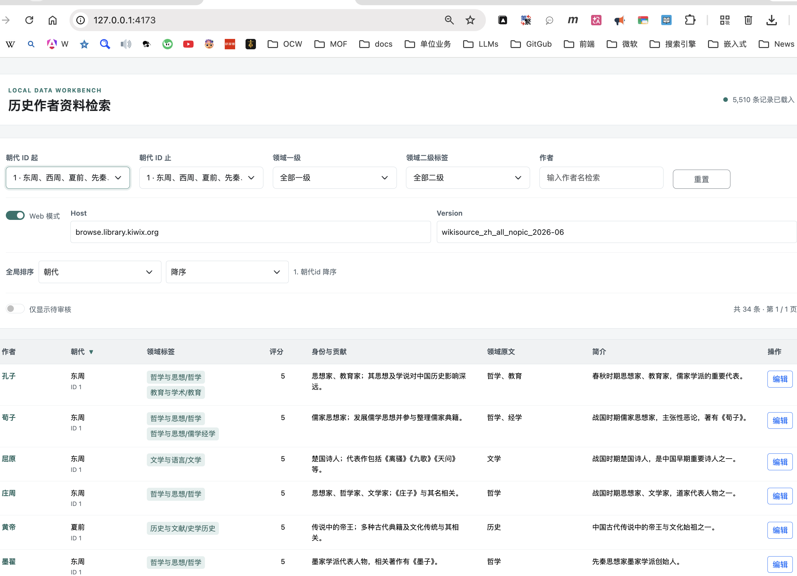
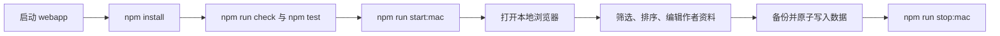
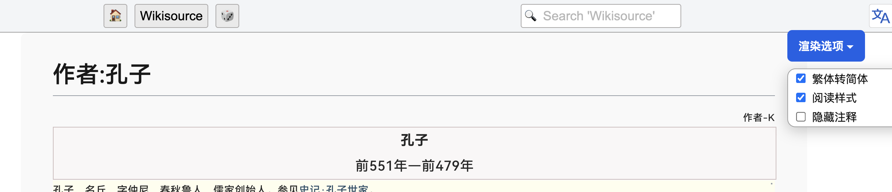
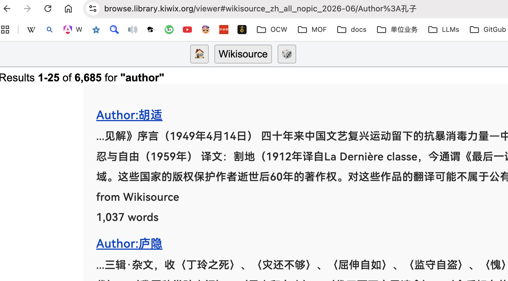
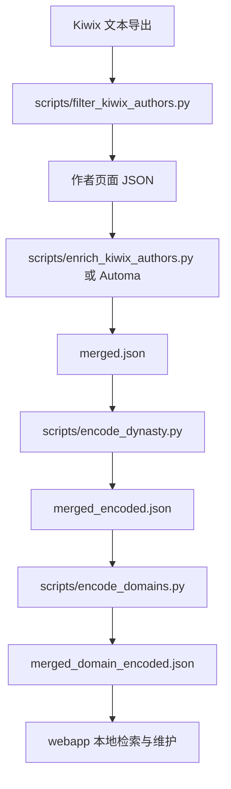

# 历史作者资料工具集

用于整理、编码、检索和维护 Kiwix / Wikisource 历史作者资料。本项目将本地 Kiwix 数据、作者元数据、朝代与领域编码、本地 Web 管理界面和 Automa 浏览器工作流组合在一起，适合快速浏览作者资料，也适合继续开发数据加工流程。

> **当前定位：** 这是一个面向本机使用的工具集。Web 服务默认只监听回环地址；数据处理脚本和 Automa 工作流属于开发/维护流程，运行前请先确认输入文件、输出目录和目标 Kiwix 版本。

## 目录

- [项目能做什么](#项目能做什么)
- [开箱即用：启动本地 Web 应用](#开箱即用启动本地-web-应用)
- [Web 应用功能](#web-应用功能)
- [现有流程截图](#现有流程截图)
- [Automa 工作流](#automa-工作流)
- [开发模式：数据采集与加工](#开发模式数据采集与加工)
- [数据文件与安全边界](#数据文件与安全边界)
- [验证与故障排查](#验证与故障排查)
- [项目目录](#项目目录)

## 项目能做什么

### 面向使用者

- 在本机浏览由 Kiwix / Wikisource 整理出的历史作者资料。
- 按朝代 ID 区间、领域分类、作者姓名和审核状态筛选记录。
- 对结果排序、分页，并查看作者的身份、贡献、领域原文和简介。
- 在允许的字段范围内编辑记录；成功编辑前会创建备份，并通过临时文件原子替换正式数据。
- 在本地数据模式和在线 Kiwix Web Viewer 模式之间切换作者链接。

### 面向开发者

- 从 Kiwix 文本导出中筛选 `Author:<姓名>` 页面。
- 通过 Automa 或本地接口采集作者元数据。
- 为作者记录添加可审计的朝代编码和多标签领域编码。
- 使用 [`output/merged_domain_encoded.json`](output/merged_domain_encoded.json) 作为 Web 应用的规范化数据源。

## 开箱即用：启动本地 Web 应用

### 环境要求

- macOS 或其他能够运行 Node.js 的本机环境。
- Node.js 与 npm。
- 如需执行 Python 数据处理流程，另需 Python 3。
- 如需执行浏览器自动化流程，安装支持 Automa 的浏览器及 Automa 扩展。

### 首次安装

在项目根目录执行：

```sh
cd webapp
npm install
npm run check
npm test
```

`npm run check` 检查服务端、数据存储模块、前端脚本和测试脚本的语法；`npm test` 使用临时样例数据验证数据读写、字段校验和 URL 构造，不应修改正式数据源。

### 启动服务

macOS 下推荐使用启动器：

```sh
cd webapp
npm run start:mac
```

也可以在 Finder 中双击 [`webapp/start.command`](webapp/start.command)。启动器会检查依赖、复用已经健康运行的服务，并打开浏览器。默认地址为：

```text
http://127.0.0.1:4173
```

需要指定其他端口时：

```sh
cd webapp
PORT=4174 npm run start:mac
```

传统前台方式仍可使用：

```sh
cd webapp
npm start
```

### 停止服务

停止由启动器管理的服务：

```sh
cd webapp
npm run stop:mac
```

也可以双击 [`webapp/stop.command`](webapp/stop.command)。运行时 PID、日志和状态文件位于 `webapp/.runtime/`，该目录不应提交到版本库。

> [!WARNING]
> 服务和 API 仅绑定本机回环地址，适合本机使用。不要在未增加鉴权、访问控制和网络隔离的情况下把它暴露到公网。

## Web 应用功能

本地应用位于 [`webapp/`](webapp/)，默认读取 [`output/merged_domain_encoded.json`](output/merged_domain_encoded.json)。主要功能包括：

- 按朝代 ID 区间、领域一级/二级标签、作者姓名和待审核状态筛选。
- 对完整筛选结果排序后再分页；表头支持组合排序，排序状态保存在浏览器本地。
- 支持分页、跳页和每页 20 / 50 / 100 条。
- 行内编辑作者、朝代、领域标签、评分、身份与贡献、领域原文及简介。
- 朝代从现有完整朝代元组中选择；领域编码根据领域标签映射生成。
- 作者链接支持本地路由和在线 Kiwix Viewer 路由；Web 主机、版本等设置保存在浏览器本地。
- 成功编辑前自动备份到 `output/backups/`，然后以原子方式替换规范化 JSON 文件。
- 窄屏设备使用紧凑卡片布局，避免页面整体横向溢出。

详细的启动、功能和测试说明见 [`webapp/README.md`](webapp/README.md)。

## 现有流程截图

以下图片来自项目现有资料，保留用于说明使用场景和操作流程。图片中的具体界面可能随 Kiwix 版本、浏览器窗口大小和本地数据变化而变化。

### 1. Kiwix / Wikisource 使用场景


该图用于说明项目所围绕的 Kiwix / Wikisource 浏览与资料整理场景。

### 2. 本地 Web 应用启停



该图用于配合“开箱即用”章节，说明如何启动或停止本地 Web 应用。实际操作以 [`webapp/start.command`](webapp/start.command) 和 [`webapp/stop.command`](webapp/stop.command) 为准。



该流程图补充说明本地 Web 应用从安装、验证、启动到停止的基本操作路径。

### 3. OpenCC + CSS 繁简样式优化



该图对应 [`automa/Kiwix：HTTP Request 下载 OpenCC + CSS 繁简样式优化-v12.automa.json`](automa/Kiwix%EF%BC%9AHTTP%20Request%20%E4%B8%8B%E8%BD%BD%20OpenCC%20%2B%20CSS%20%E7%B9%81%E7%AE%80%E6%A0%B7%E5%BC%8F%E4%BC%98%E5%8C%96-v12.automa.json)，用于说明在 Kiwix 页面上下载 OpenCC 资源并应用繁简样式优化的自动化流程。

### 4. Author 查询与作者元数据



该图用于说明在指定 Kiwix Wikisource 的 Author 查询模式下获取作者元数据的流程。相关导出数据示例位于 [`attachment/kiwix-authors-person.json`](attachment/kiwix-authors-person.json)。



该流程图补充说明原始 Kiwix 数据如何加工为 Web 应用使用的规范化数据源。

## Automa 工作流

工作流文件集中在 [`automa/`](automa/)。导入前请先确认 Automa 版本、目标 Kiwix 域名和当前 Viewer 是否已经完整加载。

### Kiwix 页面样式优化

当前相关工作流包括：

- [`automa/Kiwix：HTTP Request 下载 OpenCC + CSS 繁简样式优化-v10.automa.json`](automa/Kiwix%EF%BC%9AHTTP%20Request%20%E4%B8%8B%E8%BD%BD%20OpenCC%20%2B%20CSS%20%E7%B9%81%E7%AE%80%E6%A0%B7%E5%BC%8F%E4%BC%98%E5%8C%96-v10.automa.json)
- [`automa/Kiwix：HTTP Request 下载 OpenCC + CSS 繁简样式优化-v11.automa.json`](automa/Kiwix%EF%BC%9AHTTP%20Request%20%E4%B8%8B%E8%BD%BD%20OpenCC%20%2B%20CSS%20%E7%B9%81%E7%AE%80%E6%A0%B7%E5%BC%8F%E4%BC%98%E5%8C%96-v11.automa.json)
- [`automa/Kiwix：HTTP Request 下载 OpenCC + CSS 繁简样式优化-v12.automa.json`](automa/Kiwix%EF%BC%9AHTTP%20Request%20%E4%B8%8B%E8%BD%BD%20OpenCC%20%2B%20CSS%20%E7%B9%81%E7%AE%80%E6%A0%B7%E5%BC%8F%E4%BC%98%E5%8C%96-v12.automa.json)

通常流程是：在目标 Kiwix Viewer 页面导入工作流，确认页面资源和权限可用，再运行 HTTP Request 与页面样式处理步骤。不同版本用于保留迭代结果，使用前应在目标页面验证。

### Author 全量查询导出

相关工作流包括：

- [`automa/Kiwix：HTTP Request Author 全量查询导出 TXT-v1.automa.json`](automa/Kiwix%EF%BC%9AHTTP%20Request%20Author%20%E5%85%A8%E9%87%8F%E6%9F%A5%E8%AF%A2%E5%AF%BC%E5%87%BA%20TXT-v1.automa.json)
- [`automa/Kiwix：HTTP Request Author 全量查询导出 TXT-v2.automa.json`](automa/Kiwix%EF%BC%9AHTTP%20Request%20Author%20%E5%85%A8%E9%87%8F%E6%9F%A5%E8%AF%A2%E5%AF%BC%E5%87%BA%20TXT-v2.automa.json)

使用步骤：

1. 打开目标 Kiwix Wikisource 的 Author 查询页面，或打开对应 Web Viewer 页面。
2. 确认 Viewer 及其搜索 iframe 已完成加载。
3. 在 Automa 中导入工作流并检查起始 URL、目标域名和导出设置。
4. 运行工作流，按分页请求收集 Author 查询结果并导出 TXT。
5. 将导出的文本作为后续作者筛选和元数据处理的输入。

> [!WARNING]
> Automa 工作流的实际导入和运行结果依赖目标 Kiwix 站点、Viewer 版本、浏览器权限和 Automa 配置。文档不把未在目标环境中完成的运行验证描述为已验证结果。

## 开发模式：数据采集与加工

推荐从项目根目录执行脚本，确保默认的 `output/` 路径可正确解析。当前数据链路如下：

```text
Kiwix 文本导出
    ↓
filter_kiwix_authors.py
    ↓
作者页面 JSON
    ↓
enrich_kiwix_authors.py / Automa 作者元数据
    ↓
merged.json
    ↓
encode_dynasty.py
    ↓
merged_encoded.json
    ↓
encode_domains.py
    ↓
merged_domain_encoded.json
    ↓
webapp/ 本地检索与维护
```

### 1. 筛选作者页面

[`scripts/filter_kiwix_authors.py`](scripts/filter_kiwix_authors.py) 从 Kiwix 文本导出中保守筛选单作者页面，排除机构、主题页、文档页和子页面。该脚本需要显式传入输入和输出：

```sh
python3 scripts/filter_kiwix_authors.py <kiwix-export.txt> <author-pages.json>
```

### 2. 补充作者元数据

[`scripts/enrich_kiwix_authors.py`](scripts/enrich_kiwix_authors.py) 支持两类接口：

- **OpenAI 兼容 Chat Completions**：默认使用 `http://127.0.0.1:8000/v1/chat/completions`，适用于本地模型服务或其他提供 `/v1/chat/completions` 的服务；端口和主机不是固定值。
- **旧版 FlexLLM 网关**：继续兼容原来的 `http://127.0.0.1:9004/v1/chat` 协议，但只有显式使用该 URL 或 `--protocol flexllm` 时才依赖 settings 文件。

OpenAI 兼容服务示例：

```sh
export OPENAI_BASE_URL="http://127.0.0.1:8000/v1"
export OPENAI_API_KEY="本机服务需要时填写；无需鉴权时可留空"
export OPENAI_MODEL="本地服务公布的模型名"
python3 scripts/enrich_kiwix_authors.py \
  --input attachment/kiwix-authors-person.json \
  --output-dir output/clips
```

也可以全部通过命令行传入：

```sh
python3 scripts/enrich_kiwix_authors.py \
  --protocol openai \
  --base-url http://127.0.0.1:1234/v1 \
  --model <model-name> \
  --api-key <optional-token> \
  --input attachment/kiwix-authors-person.json \
  --output-dir output/clips
```

`--base-url` 和 `OPENAI_BASE_URL` 接受服务根地址，并自动补全 `/chat/completions`；也可以使用 `--url` 或 `AUTHOR_LLM_URL` 直接传入完整接口地址。这样可以兼容不同端口、不同主机以及常见 OpenAI 兼容本地服务，不再依赖固定的 9004 端口。

兼容旧版 9004 网关：

```sh
python3 scripts/enrich_kiwix_authors.py \
  --protocol flexllm \
  --url http://127.0.0.1:9004/v1/chat \
  --settings <path/to/settings.yaml> \
  --provider huoshan \
  --input attachment/kiwix-authors-person.json \
  --output-dir output/clips
```

接口会自动按 URL 判断协议，也可以用 `--protocol openai` 或 `--protocol flexllm` 强制指定。OpenAI 兼容响应要求标准的 `choices[0].message.content`，内容必须是脚本约定的 JSON；脚本会发送 `Authorization: Bearer ...`（仅在提供 API key 时），不会把密钥写入输出文件。

环境变量速查：

| 变量 | 作用 |
| --- | --- |
| `AUTHOR_LLM_URL` | 完整接口 URL；优先用于通用协议入口 |
| `OPENAI_BASE_URL` | OpenAI 兼容服务根地址，自动补全 `/chat/completions` |
| `OPENAI_API_KEY` | OpenAI 兼容服务的 Bearer token，可为空 |
| `OPENAI_MODEL` | OpenAI 兼容服务要求的模型名 |
| `FLEXLLM_SETTINGS` | 旧版 FlexLLM settings 文件路径 |

该脚本的旧版 FlexLLM 默认外部配置路径可能因本机环境不同而不同，不建议直接依赖他人的默认配置。使用 `--help` 查看完整参数：

```sh
python3 scripts/enrich_kiwix_authors.py --help
```

### 3. 生成朝代编码

[`scripts/encode_dynasty.py`](scripts/encode_dynasty.py) 读取 `output/merged.json`，生成带朝代/时间桶编码的 `output/merged_encoded.json`：

```sh
python3 scripts/encode_dynasty.py
```

朝代 ID 用于时间排序和筛选，不应简单理解为唯一的历史政权 ID；并存政权可以共享时间桶。

### 4. 生成领域编码

[`scripts/encode_domains.py`](scripts/encode_domains.py) 读取 `output/merged_encoded.json`，生成多标签领域编码和审核表：

```sh
python3 scripts/encode_domains.py
```

默认输出为：

- [`output/merged_domain_encoded.json`](output/merged_domain_encoded.json)：Web 应用使用的规范化数据源。
- [`output/domain_review.csv`](output/domain_review.csv)：领域编码审核结果。

### 5. 运行 Python 语法检查

```sh
python3 -m py_compile scripts/*.py
```

> **开发模式图示：** 数据采集与加工流程已在上方“开发模式：数据采集与加工”章节使用 Mermaid 流程图表示。

## 数据文件与安全边界

- [`output/merged_domain_encoded.json`](output/merged_domain_encoded.json) 是当前 Web 应用读取的规范化数据源，修改前应确认数据版本并保留备份。
- `output/backups/` 用于 Web 应用成功编辑前的运行时备份，已加入忽略规则。
- `output/clips/`、批处理 JSON、审核 CSV 和其他中间文件属于生成产物，提交前应确认是否需要纳入版本控制。
- [`attachment/`](attachment/) 保存当前项目附带的输入资料和元数据示例；不要在未确认来源和用途的情况下覆盖原始资料。
- [`webapp/node_modules/`](webapp/node_modules/) 和 [`webapp/.runtime/`](webapp/.runtime/) 不应提交。
- 不要把 API 密钥、个人配置、模型服务地址或本地路径写入公开版本库。
- 当前项目未假设已经初始化 Git；首次提交前应仔细检查 `git status --short`。

## 验证与故障排查

### Web 应用验证

```sh
cd webapp
npm run check
npm test
```

如果无法启动：

1. 确认已经在 [`webapp/`](webapp/) 执行 `npm install`。
2. 检查端口 4173 是否被其他服务占用；必要时使用 `PORT=4174`。
3. 确认 [`output/merged_domain_encoded.json`](output/merged_domain_encoded.json) 存在且为合法 JSON。
4. 查看 `webapp/.runtime/` 中的启动日志。
5. 使用 `npm start` 前台运行，以便直接查看 Node.js 错误。

### Automa 验证

- 确认工作流 JSON 可以导入。
- 确认目标页面已加载完成，特别是 Viewer 搜索 iframe。
- 确认浏览器允许工作流访问目标域名和下载文件。
- 小范围运行后再进行全量导出，避免产生无法审查的大批量结果。

### 数据处理验证

- 每个脚本执行前确认输入文件和输出文件路径。
- 不要用正式数据源作为破坏性测试目标。
- 在处理大批量数据前先使用小样本或单批次验证。
- 运行完成后检查记录数、关键字段、输出 JSON 合法性和审核结果。


## 许可与数据来源

当前目录未声明统一的开源许可证或外部数据授权条款。发布或共享前，请分别确认 Kiwix / Wikisource 数据、作者资料、图片、Automa 工作流和第三方依赖的使用条件。
